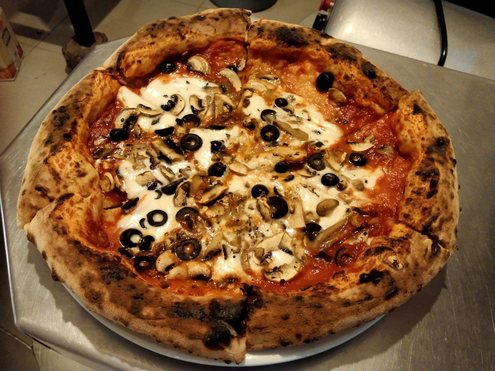

# La Spezia — Design Spec (v2: trilingual + real photos)

Single-page, information-only website (no reservations, no ordering) for **La Spezia**, a family-run pizzeria / Italian restaurant in Rinconada, Puerto Escondido, Oaxaca.
Deliverable: `la-spezia/index.html` + `styles.css` + `main.js` (vanilla, < 4 KB) + `images/` folder. No frameworks. Google Fonts only.
**Trilingual: Español (default) · Italiano · English**, with a 3-way switcher.
**Photos:** real photos from the restaurant's Google Maps listing (user reports permission from the owner), saved locally under `la-spezia/images/`. Never hotlinked. SVG/CSS art stays as accents and as fallbacks.

---

## 1. Concept and feeling

**"Una noche en la esquina" / "Una sera all'angolo" / "A night on the corner."** The page should feel like walking up to La Spezia at dusk: string lights warming up over the open-air corner, the dome oven glowing, a red sign with white hand-lettered script, a black chalkboard listing the pizzas, checked tablecloths, fans turning, a cold beer on the table. The real photos carry the appetite (blistered crusts, the oven, the corner at night); the design around them supplies the textures of the place — red signage, chalk, checks, crust browns and bulb glow. Warm, unfussy, a little playful and clearly *made by hand*: a neighborhood trattoria run by an Italian pizzaiolo, not a polished chain. Information first (what they make, when they're open, how to get there, where to follow them). It is a gift, so it should feel personal and proud, and be easy for the owner to update (hours, photos, menu) without a developer.

---

## 2. Typography

Google Fonts, one `<link>` with `display=swap`, preconnect to `fonts.googleapis.com` and `fonts.gstatic.com`. All four families cover Spanish and Italian accents (á é í ó ú ñ ¡ ¿ / à è é ì ò ù).

| Role | Font | Weights | Use |
|---|---|---|---|
| Signage script | **Yellowtail** | 400 | Wordmark "La Spezia", section kickers. Never body, never < 28px. |
| Display / headings | **Fraunces** | 600, 800, italic 600 | H1/H2/H3. On H1/H2: `font-variation-settings: "SOFT" 100, "WONK" 1`. |
| Chalkboard | **Caveat** | 500, 700 | Menu dish names and prices on the board, handwritten notes. Min 22px. |
| Body / UI | **Work Sans** | 400, 500, 600 | Paragraphs, hours, address, buttons, nav, switcher. |

Fallbacks:
- `--font-script: "Yellowtail", "Brush Script MT", cursive;`
- `--font-display: "Fraunces", Georgia, "Times New Roman", serif;`
- `--font-chalk: "Caveat", "Comic Sans MS", cursive;`
- `--font-body: "Work Sans", system-ui, -apple-system, "Segoe UI", sans-serif;`

### Scale (fluid, `clamp()`)

| Token | Value | Use |
|---|---|---|
| `--step--1` | `clamp(0.875rem, 0.85rem + 0.1vw, 0.95rem)` | captions, footnotes |
| `--step-0` | `clamp(1rem, 0.96rem + 0.2vw, 1.125rem)` | body (16 → 18px) |
| `--step-1` | `clamp(1.2rem, 1.1rem + 0.45vw, 1.45rem)` | H3, lead, chalk dish names (≥ 1.45rem for chalk) |
| `--step-2` | `clamp(1.5rem, 1.3rem + 0.9vw, 2rem)` | script kickers |
| `--step-3` | `clamp(1.9rem, 1.5rem + 1.8vw, 3rem)` | H2 |
| `--step-4` | `clamp(2.6rem, 1.9rem + 3.4vw, 4.75rem)` | hero H1 |
| `--step-5` | `clamp(3.5rem, 2.4rem + 5.5vw, 7rem)` | hero wordmark |

Body line-height 1.6, headings 1.1, script 1.0. Measure max 62ch. Tiny labels: Work Sans 600, uppercase, `0.08em` tracking. Italian and Spanish strings run ~10–20% longer than English: buttons and nav must wrap gracefully (no fixed widths, `text-wrap: balance` on headings).

---

## 3. Color tokens

Contrast ratios computed with WCAG 2.x relative luminance. AA normal text needs 4.5:1; large text (≥ 24px, or ≥ 18.66px bold) needs 3:1.

```css
:root {
  color-scheme: light;
  /* Palette (from the Google Maps photo mood) */
  --tomato:        #B3262B;  /* brick/tomato red: signage, primary */
  --tomato-deep:   #8F1E22;  /* hover/pressed, red text on cream */
  --warm-white:    #F2EEE6;  /* page background (day sections) */
  --crust:         #7A4A2A;  /* charred crust brown */
  --basil:         #4F7A3A;  /* decorative / large text only */
  --basil-deep:    #3E6230;  /* basil for small text */
  --cheese:        #E8D8B0;  /* cards, light checks */
  --asphalt:       #1E1E22;  /* night sections, frames */
  --chalkboard:    #2B2F2C;  /* green-black board surface */
  --bulb:          #F2C46B;  /* glow, accents on dark */
  --terracotta:    #C9582E;  /* decorative only on light */
  --terracotta-ink:#A8442A;  /* terracotta for text on cream */
  --ember:         #E86A4E;  /* terracotta-ish text on dark */
  --muted-ink:     #6B6560;  /* secondary text on cream */
  --muted-chalk:   #B8B2A8;  /* secondary text on dark */

  /* Semantic */
  --bg: var(--warm-white);       --text: var(--asphalt);
  --text-muted: var(--muted-ink); --accent: var(--tomato);
  --accent-text: var(--tomato-deep);
  --bg-night: var(--asphalt);    --text-night: var(--warm-white);
  --text-night-muted: var(--muted-chalk);
  --focus: var(--bulb);          /* on dark / red / over photos */
  --focus-light: var(--tomato-deep); /* on light */

  /* Photo overlays (see §5) */
  --scrim-hero: linear-gradient(180deg, rgb(30 30 34 / .55) 0%, rgb(30 30 34 / .25) 35%, rgb(30 30 34 / .80) 100%);
  --scrim-caption: linear-gradient(0deg, rgb(30 30 34 / .85), rgb(30 30 34 / 0) 70%);
  --warm-tint: rgb(242 196 107 / .12); /* bulb tint, blend-mode: soft-light */

  --radius: 14px;
  --shadow-warm: 0 10px 30px -12px rgb(122 74 42 / .45);
}
```

### Contrast-checked pairings (anything not listed is decorative only)

| Foreground | Background | Ratio | OK for |
|---|---|---|---|
| asphalt `#1E1E22` | warm-white `#F2EEE6` | 14.36 | all text |
| warm-white | asphalt | 14.36 | all text |
| warm-white | chalkboard `#2B2F2C` | 11.74 | all text |
| cheese `#E8D8B0` | asphalt | 11.77 | all text |
| asphalt | cheese | 11.77 | all text |
| bulb `#F2C46B` | asphalt / chalkboard | 10.19 | all text |
| muted-chalk `#B8B2A8` | asphalt | 7.89 | secondary on dark |
| tomato-deep `#8F1E22` | warm-white | 7.64 | links, red text on light |
| crust `#7A4A2A` | warm-white | 6.39 | text accents, captions |
| basil-deep `#3E6230` | warm-white | 6.06 | small green text |
| tomato `#B3262B` | warm-white | 5.62 | text, buttons |
| warm-white | tomato | 5.62 | button labels, sign text |
| ember `#E86A4E` | asphalt | 5.22 | text on dark |
| terracotta-ink `#A8442A` | warm-white | 5.15 | text |
| muted-ink `#6B6560` | warm-white | 4.96 | secondary text |
| tomato | cheese | 4.61 | text (prefer tomato-deep) |
| basil `#4F7A3A` | warm-white | 4.34 | **large text / icons only** |
| bulb | tomato | 3.99 | **large text only** |
| terracotta `#C9582E` | warm-white | 3.69 | **decorative only** |

**Text over photos:** never rely on the photo. Text over an image always sits on a scrim that brings the area under the text to at least asphalt @ 70% (effective ratio ≥ 7:1 for warm-white text against the darkest-to-lightest plausible photo pixels), plus `text-shadow: 0 1px 2px rgb(0 0 0 / .5)`. Small text (< 24px) over photos goes on a solid asphalt or tomato chip instead.

No dark-mode inversion: the page already alternates light ("day") and dark ("night") sections.

---

## 4. Photo plan

### 4.1 Sourcing and preparation
- Source: the restaurant's own Google Maps listing photos, with the owner's permission (user-reported; reconfirm before launch, §9). Prefer photos uploaded by the owner over customer uploads; if a customer photo is used, the owner should be comfortable with it.
- Download once, save locally. **Never hotlink Google URLs** (they expire and leak visitor data).
- Export: JPEG (quality ~78) plus optional WebP alongside; sRGB; strip EXIF/GPS metadata. Target ≤ 250 KB for hero (2000px wide), ≤ 140 KB for others.
- Gentle, consistent grade only: slight warmth (+ temperature), lift shadows a touch. No heavy filters; the food must look like the real food.
- Avoid photos where customers' faces are clearly identifiable unless the owner confirms it's okay; prefer food, oven, signage, the corner, staff at work (with consent).

### 4.2 Expected files (`la-spezia/images/`)

| File | Content to pick | Min size | Aspect / crop | Used in |
|---|---|---|---|---|
| `hero.jpg` | Night shot of the corner/terrace with string lights and red sign, **or** a pizza coming out of the dome oven | 2000×1333 | Wide 3:2 source; art-directed (below) | Hero background |
| `hero-mobile.jpg` *(optional)* | Same scene cropped portrait | 1080×1440 | 3:4 | Hero on < 48rem via `<picture>` |
| `ambiente-1.jpg` | Ambiance: open-air seating, ceiling fans, checked tablecloths, plants, lights | 1400×1750 | 4:5 portrait | Story section |
| `ambiente-2.jpg` *(optional)* | Second ambiance: sign or chalkboard or the oven itself | 1400×1050 | 4:3 | Visit section header image |
| `food-1.jpg` | Hero pizza close-up, leopard-spotted crust | 1200×1200 | 1:1 | Food strip (lead tile) |
| `food-2.jpg` | Another pizza (e.g., Frutti di Mare or Capricciosa) | 1200×1500 | 4:5 | Food strip |
| `food-3.jpg` | Handmade pasta (Carbonara / Alfredo / Ravioli) | 1200×1500 | 4:5 | Food strip |
| `food-4.jpg` | Calzone or Filete a la Veracruzana | 1200×1200 | 1:1 | Food strip |
| `food-5.jpg` | Cocktail or cold beer on a table | 1200×1500 | 4:5 | Food strip |
| `food-6.jpg` *(optional)* | Salad / vegetarian dish | 1200×1200 | 1:1 | Food strip |

Builder must code for the required files (`hero.jpg`, `ambiente-1.jpg`, `food-1..5.jpg`) and gracefully handle any missing file, including optional ones.

### 4.3 Art direction and cropping
- Use `` (not CSS backgrounds) for every content photo so alt text, `loading`, and `srcset` work. Crop in the browser with `object-fit: cover` and a per-image focal point via a custom property: `style="--focus-x: 50%; --focus-y: 60%"` → `object-position: var(--focus-x) var(--focus-y)`. Document the focal point next to each `` in an HTML comment so the owner can adjust after swapping.
- **Hero:** `<picture>` with `hero-mobile.jpg` for `(max-width: 47.99rem)` if present, else `hero.jpg` with focal point biased to the subject (oven mouth / sign). Mobile height `min(78svh, 680px)`, desktop `min(88svh, 860px)`. Keep the subject in the right/lower third on desktop so the left side holds the text; on mobile, text sits in the bottom 45% over the scrim.
- **Food strip:** consistent tight crops — fill the frame with food, crust edge visible, minimal background. Plates centered (`--focus-y` ~ 55%).
- **Ambiance (story):** portrait 4:5, include lights or fans at the top edge so the "string-light" SVG accent can visually continue from them.
- Explicit `width`/`height` attributes on all images (aspect-ratio boxes) to prevent layout shift.

### 4.4 Overlays and treatments
- **Hero scrim:** `--scrim-hero` layered over the image, plus a bulb radial glow from the top (`radial-gradient(ellipse at 50% -10%, rgb(242 196 107 / .30), transparent 60%)`) and a faint `--warm-tint` with `mix-blend-mode: soft-light`. The SVG string lights hang across the top of the photo.
- **Food tiles:** rounded `--radius`, `--shadow-warm`, a caption chip bottom-left on `--scrim-caption` (warm-white Work Sans 500, ≥ 16px). On desktop hover (motion-safe), image scales 1.03 inside its frame.
- **Ambiance:** polaroid treatment — 10px warm-white border (16px at the bottom), +1.5° tilt on desktop, a strip of "masking tape" (cheese rectangle at 70% opacity) at the top.
- **Red-sign duotone option (CSS only, optional):** for a photo too busy to read, `filter: grayscale(1) contrast(1.1)` with a tomato `mix-blend-mode: multiply` layer — reserved for decorative backdrop use only, never for food.
- No text baked into images.

### 4.5 Fallbacks if an image is missing
Each photo sits in a frame element that already looks finished without the image:

```html
<figure class="photo photo--food" style="--focus-x:50%; --focus-y:55%">
  <!-- ✏️ EDIT: PHOTO food-1.jpg — focal point via --focus-x / --focus-y -->
  
  <figcaption data-es="…" data-it="…" data-en="…">…</figcaption>
</figure>
```
- (The `onerror` may instead be wired in `main.js` with a capture-phase `error` listener on `document`; the inline version is acceptable because it also covers images that fail before JS runs.)
- `.photo` frame always has a background so a missing or still-loading image shows art, not a broken icon:
  - **Food tiles fallback:** cheese background + `.checks` pattern at 12% + a centered inline-SVG pizza (leopard-spot crust) in tomato/crust, caption still shown.
  - **Hero fallback:** asphalt background + bulb radial glow + the SVG dome-oven illustration on the right (desktop) / below text (mobile). The hero must look intentional with zero photos — this is the "v1 art" hero kept as the fallback.
  - **Ambiance fallback:** tomato panel with the warm-white Yellowtail line "Un pedacito de Italia" / "Un pezzetto d'Italia" / "A little piece of Italy" and tiny string lights.
- When `.is-missing` is set, the `alt` text is no longer needed (decorative fallback); the figure gets `aria-hidden="true"` only if the caption is purely visual — otherwise keep the caption readable.
- Images use `loading="lazy"` except `hero` (`fetchpriority="high"`, eager). Add `<link rel="preload" as="image" href="images/hero.jpg">`.

### 4.6 Alt text (all three languages)
Alt text describes what's actually in each chosen photo. Below are **defaults matching the intended content**; the builder/owner must adjust after looking at the selected photo. Switcher swaps `alt` from `data-alt-es|it|en`.

| File | ES | IT | EN |
|---|---|---|---|
| `hero.jpg` (night corner) | La esquina de La Spezia de noche, con luces colgantes y mesas al aire libre | L'angolo di La Spezia di sera, con le lucine accese e i tavoli all'aperto | La Spezia's corner at night, with string lights and outdoor tables |
| `hero.jpg` (oven variant) | Una pizza saliendo del horno de domo | Una pizza che esce dal forno a cupola | A pizza coming out of the dome oven |
| `ambiente-1.jpg` | Mesas al aire libre bajo los ventiladores, con manteles a cuadros | Tavoli all'aperto sotto i ventilatori, con le tovaglie a quadretti | Open-air tables under the ceiling fans, with checked tablecloths |
| `ambiente-2.jpg` | El letrero rojo de La Spezia | L'insegna rossa di La Spezia | La Spezia's red sign |
| `food-1.jpg` | Pizza recién salida del horno con la orilla dorada y tostada | Pizza appena sfornata, con il cornicione dorato e bruciacchiato | Fresh-baked pizza with a golden, blistered crust |
| `food-2.jpg` | Pizza de mariscos Frutti di Mare | Pizza ai frutti di mare | Frutti di Mare seafood pizza |
| `food-3.jpg` | Plato de pasta hecha a mano | Un piatto di pasta fatta a mano | A plate of handmade pasta |
| `food-4.jpg` | Calzone dorado recién horneado | Calzone dorato appena sfornato | Golden calzone, fresh from the oven |
| `food-5.jpg` | Un cóctel y una cerveza fría en la mesa | Un cocktail e una birra fresca sul tavolo | A cocktail and a cold beer on the table |
| `food-6.jpg` | Ensalada fresca | Insalata fresca | Fresh salad |

---

## 5. Page structure and layout

Mobile-first (base 360px), side gutter `--gutter: clamp(16px, 4vw, 40px)`, content max-width 1120px, chalkboard max 880px. Breakpoints `48rem` and `64rem`. No horizontal scroll at any width (the food strip scrolls inside its own container).

```
<a class="skip-link" href="#main">
<header class="site-header">        sticky red bar: wordmark · nav · ES/IT/EN switcher
<main id="main">
  <section id="inicio"   class="hero">            photo + scrim + string lights
  <section id="historia" class="story day">       text + ambiente-1 polaroid
  <section id="cocina"   class="food-strip day">  food-1..6
  <section id="menu"     class="menu night">      chalkboard
  <section id="visita"   class="visit day-checked"> hours + address + map link
  <section id="redes"    class="social tomato">
</main>
<footer class="site-footer night">
```

### 5.1 Header
- **Mobile:** 56px sticky, `--tomato` background with a 6px red/warm-white checkered strip at its bottom. Left: "La Spezia" Yellowtail 30px warm-white. Right: language switcher (3-segment pill: `ES | IT | EN`) and a "Menú ☰" button (`aria-expanded`, `aria-controls`) opening a full-width anchor list.
- **Desktop:** 68px; nav links inline (Work Sans 500 warm-white, bulb underline on hover). Switcher far right.
- Over the hero the header may start transparent (asphalt 0 → tomato on scroll, JS class); without JS it's solid tomato.

### 5.2 Hero — the corner at night (photo)
- `hero.jpg` full-bleed with `--scrim-hero`, glow and tint (§4.4). SVG string lights (catenary in crust, 9–14 bulbs with glow) hang across the top edge, over the photo.
- **Content:** mobile bottom-aligned, centered; desktop left column (max 560px), vertically centered.
  - Kicker (Work Sans caps, cheese): Pizzería · Ristorante · Puerto Escondido
  - Wordmark "La Spezia" in Yellowtail `--step-5` on a hand-painted red sign shape (wobbly SVG rounded rect, tomato, thin warm-white inner stroke, -2° tilt).
  - H1 Fraunces 800 `--step-4` warm-white.
  - Lead in cheese `--step-1`.
  - Buttons: primary tomato "Ver el menú" → `#menu`; secondary bulb-outline "Cómo llegar" → `#visita`; tel link.
- Fallback: v1 art hero (asphalt + glow + SVG dome oven with leopard-spotted pizza on a peel).
- Bottom edge: 12px checkered band into the story.

### 5.3 Story — "Un pedacito de Italia"
- Warm-white with faint paper grain (SVG `feTurbulence` data-URI at 4%).
- **Mobile:** script kicker (tomato), H2, two paragraphs, fact chips (Hecho a mano · Horno de domo · Al aire libre · Opciones vegetarianas, with tiny basil/crust SVG icons), then `ambiente-1.jpg` polaroid (4:5).
- **Desktop:** 2 columns: text left (≤ 56ch), polaroid right, tilted +1.5°, a small SVG string-light swag peeking over its top.
- Pull-quote below in Caveat, crust, with a hand-drawn underline SVG: *"Berlín cambió los atracos por la mejor pizza, pasta y calzone."* Always shown in the original Spanish (`lang="es"`), with a small gloss in IT/EN modes.

### 5.4 Food strip — "De nuestro horno"
- Warm-white. Script kicker + H2 + one line.
- **Mobile:** horizontal scroll-snap strip (`overflow-x: auto; scroll-snap-type: x mandatory;` tiles 78vw wide, gap 12px, `scroll-padding` = gutter), with a visible partial next tile as the affordance. The strip is a `<ul>` with `aria-label`; it's keyboard scrollable (`tabindex="0"` on the scroller, with focus ring). No auto-advance, no arrows required.
- **Desktop (≥ 64rem):** becomes a mosaic grid: 3 columns, `food-1` spans 2 rows; tiles alternate ±0.75° tilt; caption chips bottom-left.
- Each tile: `figure.photo.photo--food` with fallback (§4.5). Captions name the dish only if the photo is confirmed to show that dish; otherwise generic ("Pizza al horno de domo").

### 5.5 Menu — the chalkboard
- Asphalt section, smaller string-light glow, basil tropical-leaf silhouettes (35% opacity) in the corners.
- **Board:** chalkboard surface, 14px wooden frame (crust gradient + inset shadow), chalk-dust smudges (white radial gradients at 3–5%). Max 880px, -0.5° tilt on desktop only.
- Header: "Menú" Caveat 700 `--step-4` with chalk underline; sub-line in bulb.
- Columns: 1 on mobile, 2 at ≥ 48rem. Groups:
  1. **Pizzas** — Champiñones y Aceitunas (MXN 200, veg*), Frutti di Mare (MXN 240), Gustosa (MXN 220), Ortolana (veg*), Capricciosa, Quattro Formaggi (veg*), Calzone.
  2. **Pasta** — Puttanesca (MXN 240), Fettuccine Alfredo (veg*), Fettuccine Alfredo con camarones, Carbonara, Ravioli di Carne.
  3. **Del mar y más** — Filete a la Veracruzana (MXN 240), Ensalada César.
  4. **Para tomar** — Cócteles · Cerveza fría.
  (*veg marks inferred from names — confirm; categories for Gustosa/Puttanesca as sourced — confirm.)
- Item row: name Caveat 700 warm-white, dotted chalk leader, price Caveat bulb only where sourced. No "TBD". Veg items: basil leaf SVG + sr-only "(vegetariana / vegetariana / vegetarian)".
- Dish names stay as-is in all languages (they're names); only group headings, notes and a few descriptive names translate (see §7).
- Footnote (Work Sans, muted-chalk).
- Plain HTML lists; `<!-- ✏️ EDIT: MENU — leave price empty if unknown -->`.

### 5.6 Visit — hours, address, map
- Warm-white with a large faint checked tablecloth (`repeating-conic-gradient`, tomato at 8%).
- Optional header image `ambiente-2.jpg` as a wide 21:9 band at the top of the section (fallback: checkered band).
- **Mobile:** stacked cheese cards: (1) Hours, (2) Address with "Abrir en Google Maps" and "Llamar" buttons, (3) Price & vibe.
- **Map:** no iframe by default. Inline SVG hand-drawn map (boulevard labeled "Blvd. Benito Juárez", corner with red pin and script wordmark, wavy coast "Océano Pacífico"), `aria-hidden`, next to the real link: `https://www.google.com/maps/search/?api=1&query=La+Spezia+Blvd.+Benito+Ju%C3%A1rez+227+Rinconada+Puerto+Escondido`. A commented-out Google Maps embed is included for the owner to enable if wanted.
- **Desktop:** 2 columns: hours + address left; map illustration + price card right.

**Editable hours block (required pattern):**
```html
<!--
  ✏️ EDIT: HOURS — ⚠ NOT CONFIRMED. Sources disagree:
    - "Daily 2:30 pm – 10:30 pm, closed Wednesday"
    - "Closes 10:00 pm"
  Confirm with the owner, edit the rows (all three languages), then set data-hours-confirmed="true".
-->
<dl class="hours" data-hours-confirmed="false">
  <div class="hours-row" data-day="1">
    <dt data-es="Lunes" data-it="Lunedì" data-en="Monday">Lunes</dt>
    <dd data-es="14:30 – 22:30" data-it="14:30 – 22:30" data-en="2:30 – 10:30 pm">14:30 – 22:30</dd>
  </div>
  <!-- … Tuesday, Thursday–Sunday same pattern … -->
  <div class="hours-row is-closed" data-day="3">
    <dt data-es="Miércoles" data-it="Mercoledì" data-en="Wednesday">Miércoles</dt>
    <dd data-es="Cerrado" data-it="Chiuso" data-en="Closed">Cerrado</dd>
  </div>
</dl>
```
- 24h format for ES and IT, 12h for EN.
- While unconfirmed, show the soft note "Los horarios pueden variar; llámanos para confirmar" (per language). Never show "Open now" until `data-hours-confirmed="true"`. JS may highlight today's row (bold + tomato left border).

### 5.7 Social — "¡Síguenos!"
- Full-bleed tomato band, checkered strips top and bottom.
- Script heading warm-white, one line, two large warm-white buttons with tomato-deep text and simple outline glyph icons:
  - Instagram **@la_spezia_restaurante** → `https://www.instagram.com/la_spezia_restaurante/`
  - Facebook **Spezia Restaurante Pizzeria** → `https://www.facebook.com/restaurante.laspezia.507`
- `target="_blank" rel="noopener"` + sr-only new-tab hint. "Loved by locals and travelers" line, no numbers.

### 5.8 Footer
- Asphalt, a 5-bulb divider, wordmark in bulb, address one-liner, phone, IG/FB text links, the Facebook line, "made with love" line, © year (static fallback, JS updates), "back to top".

---

## 6. Signature touches (accents around the photos)

1. **String lights** — SVG catenary with glowing bulbs over the hero photo, smaller swags on the story polaroid, menu section and footer divider. Gentle `flicker` (opacity .85↔1, 3–7s, staggered via `--i`).
2. **Checkered cloth** — `.checks { background: repeating-conic-gradient(var(--tomato) 0 25%, var(--warm-white) 0 50%) 0 0 / 24px 24px; }` as 6–12px edge strips, faint Visit backdrop, food-tile fallback. Never full-strength behind text.
3. **Hand-painted red sign** — hero wordmark plate.
4. **Chalkboard menu** — wood frame, chalk dust, Caveat, dotted leaders, chalk doodles (slice, basil leaf).
5. **Leopard-spot pizza SVG** — hero fallback, food-tile fallback, small bullets/dividers.
6. **Oven glow** — breathing radial gradient in the hero fallback oven.
7. **Tropical leaves** — basil silhouettes framing menu and social.
8. **Polaroid + tape** — ambiance photo.
9. **Warm grade** — soft-light bulb tint unifies photos from different phones.
10. **Scroll reveal** — fade up 12px via IntersectionObserver; content visible without JS (`html.js` enables the initial hidden state).

**Motion rules:** every animation and hover-zoom inside `@media (prefers-reduced-motion: no-preference)`. Under `reduce`: no flicker, no breathing glow, no reveal, no hover zoom, `scroll-behavior: auto`. No autoplay, carousels, or parallax.

---

## 7. Copy — Español (default) / Italiano / English

**Implementation (superseded by §11 Hugo):** the site is built with Hugo multilingual mode, so each language is its own rendered page (`/` = es, `/it/`, `/en/`) and the switcher is a set of links, not a JS text swap. The `data-es/it/en` attributes shown elsewhere in this spec are notation for "this string exists in three languages" — in Hugo they become `i18n/*.yaml` keys, per-language content front matter, or per-language fields in `data/` files (§11). **Default is always Spanish.**

### Meta
| | ES | IT | EN |
|---|---|---|---|
| title | La Spezia · Pizzería italiana en Puerto Escondido | La Spezia · Pizzeria italiana a Puerto Escondido | La Spezia · Italian Pizzeria in Puerto Escondido |
| description | Pizza y pasta hechas a mano por un pizzaiolo italiano, en horno de domo. Una esquina al aire libre en Rinconada, Puerto Escondido. | Pizza e pasta fatte a mano da un pizzaiolo italiano, cotte nel forno a cupola. Un angolo all'aperto a Rinconada, Puerto Escondido. | Hand-made pizza and pasta by an Italian pizzaiolo, from a dome oven. An open-air corner in Rinconada, Puerto Escondido. |

### Header / nav / UI
| ES | IT | EN |
|---|---|---|
| Historia | La storia | Our story |
| Cocina | Cucina | Food |
| Menú | Menù | Menu |
| Visítanos | Vieni a trovarci | Visit |
| Redes | Social | Follow |
| Switcher group label: "Idioma" | "Lingua" | "Language" |
| Buttons: ES / IT / EN, aria "Español" | "Italiano" | "English" (each language name always in its own language, `lang` set on each button) |
| Live region: "Idioma: español" | "Lingua: italiano" | "Language: English" |
| Mobile nav button: "Menú" / aria "Abrir navegación" | "Menù" / "Apri la navigazione" | "Menu" / "Open navigation" |
| Skip link: Saltar al contenido | Vai al contenuto | Skip to content |

### Hero
| | ES | IT | EN |
|---|---|---|---|
| Kicker | Pizzería · Ristorante · Puerto Escondido | Pizzeria · Ristorante · Puerto Escondido | Pizzeria · Ristorante · Puerto Escondido |
| H1 | Un pedacito de Italia en Puerto Escondido | Un pezzetto d'Italia a Puerto Escondido | A little piece of Italy in Puerto Escondido |
| Lead | Pizza hecha a mano y horneada al momento en nuestro horno de domo. Pasta artesanal, cócteles y cerveza fría, en una esquina al aire libre. | Pizza fatta a mano e cotta al momento nel nostro forno a cupola. Pasta fatta in casa, cocktail e birra fresca, in un angolo all'aperto. | Hand-made pizza, baked to order in our dome oven. Handmade pasta, cocktails and cold beer, on an open-air corner. |
| Button 1 | Ver el menú | Guarda il menù | See the menu |
| Button 2 | Cómo llegar | Come arrivare | How to find us |
| Phone | Llámanos: 954 582 2437 | Chiamaci: 954 582 2437 | Call us: 954 582 2437 |

### Story
| | ES | IT | EN |
|---|---|---|---|
| Kicker (script) | La nostra storia | La nostra storia | La nostra storia |
| H2 | Hecho a mano, como en casa | Fatto a mano, come a casa | Made by hand, like at home |
| P1 | La Spezia es un restaurante familiar. Nuestro dueño viene de Italia y es quien está al frente del horno: cada pizza se estira a mano y se hornea al momento en un gran horno de domo. | La Spezia è un ristorante di famiglia. Il titolare viene dall'Italia ed è lui il pizzaiolo: ogni pizza è stesa a mano e cotta al momento in un grande forno a cupola. | La Spezia is a family-run restaurant. Our owner comes from Italy and runs the oven himself: every pizza is stretched by hand and baked to order in a big dome oven. |
| P2 | También hacemos la pasta a mano. Ven a disfrutarla sin prisa, al aire libre, bajo los ventiladores, con un buen cóctel o una cerveza bien fría. | Anche la pasta è fatta a mano. Vieni a gustarla con calma, all'aperto sotto i ventilatori, con un buon cocktail o una birra ghiacciata. | We make our pasta by hand, too. Come enjoy it slowly, outdoors under the ceiling fans, with a good cocktail or an ice-cold beer. |
| Chips | Hecho a mano · Horno de domo · Al aire libre · Opciones vegetarianas | Fatto a mano · Forno a cupola · All'aperto · Piatti vegetariani | Hand-made · Dome oven · Open-air · Vegetarian options |
| Pull quote | "Berlín cambió los atracos por la mejor pizza, pasta y calzone." | (Spanish original) + gloss: «Berlino ha cambiato le rapine con la pizza, la pasta e il calzone migliori.» | (Spanish original) + gloss: "Berlin traded heists for the best pizza, pasta and calzone." |
| Attribution | — de nuestro Instagram | — dal nostro Instagram | — from our Instagram |

### Food strip
| | ES | IT | EN |
|---|---|---|---|
| Kicker (script) | De nuestro horno | Dal nostro forno | From our oven |
| H2 | Así sale de la cocina | Ecco cosa esce dalla cucina | Straight from the kitchen |
| Line | Masa estirada a mano, orilla dorada y tostada, ingredientes de verdad. | Impasto steso a mano, cornicione dorato e bruciacchiato, ingredienti veri. | Hand-stretched dough, a golden blistered crust, honest ingredients. |
| Strip aria-label | Fotos de nuestros platillos | Foto dei nostri piatti | Photos of our dishes |
| Default captions (edit to match photos) | Pizza al horno de domo · Frutti di Mare · Pasta hecha a mano · Calzone · Cócteles y cerveza fría · Ensalada fresca | Pizza nel forno a cupola · Frutti di mare · Pasta fatta a mano · Calzone · Cocktail e birra fresca · Insalata fresca | Dome-oven pizza · Frutti di Mare · Handmade pasta · Calzone · Cocktails & cold beer · Fresh salad |

### Menu
| | ES | IT | EN |
|---|---|---|---|
| Board title | Menú | Menù | Menu |
| Sub | Hecho a mano, al momento | Fatto a mano, al momento | Made by hand, to order |
| Group 1 | Pizzas | Pizze | Pizzas |
| Group 2 | Pasta | Pasta | Pasta |
| Group 3 | Del mar y más | Dal mare e altro | From the sea & more |
| Group 4 | Para tomar | Da bere | To drink |
| Drinks | Cócteles · Cerveza fría | Cocktail · Birra fresca | Cocktails · Cold beer |
| Champiñones y Aceitunas | Champiñones y Aceitunas | Funghi e Olive | Mushroom & Olive |
| Fettuccine Alfredo con camarones | Fettuccine Alfredo con camarones | Fettuccine Alfredo con gamberi | Fettuccine Alfredo with shrimp |
| Ensalada César | Ensalada César | Insalata Caesar | Caesar salad |
| Filete a la Veracruzana | Filete a la Veracruzana | Filetto alla Veracruzana | Fillet Veracruz-style |
| Unchanged in all | Frutti di Mare · Gustosa · Ortolana · Capricciosa · Quattro Formaggi · Calzone · Puttanesca · Fettuccine Alfredo · Carbonara · Ravioli di Carne | same | same |
| Veg legend | Vegetariana | Vegetariano | Vegetarian |
| Chalk doodle | ¡Recién salida del horno! | Appena sfornata! | Fresh out of the oven! |
| Footnote | Precios en pesos mexicanos (MXN). El menú y los precios pueden cambiar; pregunta por las especialidades del día. Aprox. MXN 200–300 por persona. | Prezzi in pesos messicani (MXN). Menù e prezzi possono variare; chiedi i piatti del giorno. Circa MXN 200–300 a persona. | Prices in Mexican pesos (MXN). Menu and prices may change; ask about today's specials. About MXN 200–300 per person. |

Prices shown: Champiñones y Aceitunas 200 · Frutti di Mare 240 · Gustosa 220 · Filete a la Veracruzana 240 · Puttanesca 240. All others: no price. Wrap Italian names in `<span lang="it">`.

### Visit
| | ES | IT | EN |
|---|---|---|---|
| Kicker (script) | Te esperamos | Ti aspettiamo | Come by |
| H2 | Visítanos | Vieni a trovarci | Visit us |
| Hours label | Horario | Orari | Hours |
| Days | Lunes · Martes · Miércoles · Jueves · Viernes · Sábado · Domingo | Lunedì · Martedì · Mercoledì · Giovedì · Venerdì · Sabato · Domenica | Monday · Tuesday · Wednesday · Thursday · Friday · Saturday · Sunday |
| Closed | Cerrado | Chiuso | Closed |
| Hours note | Los horarios pueden variar; llámanos para confirmar. | Gli orari possono variare; chiamaci per conferma. | Hours may vary; please call to confirm. |
| Address label | Dirección | Indirizzo | Address |
| Address | Blvd. Benito Juárez 227, Rinconada, 71983 Puerto Escondido, Oax., México | same (Messico) | same (Mexico) |
| Corner line | En la esquina, con mesas al aire libre. | All'angolo, con tavoli all'aperto. | On the corner, with outdoor tables. |
| Map button | Abrir en Google Maps | Apri in Google Maps | Open in Google Maps |
| Call button | Llamar al 954 582 2437 | Chiama il 954 582 2437 | Call 954 582 2437 |
| Price label | Precio | Prezzo | Price |
| Price line | Aprox. MXN 200–300 por persona | Circa MXN 200–300 a persona | About MXN 200–300 per person |
| Vibe line | Ambiente casual · al aire libre · ventiladores · opciones vegetarianas | Ambiente informale · all'aperto · ventilatori · piatti vegetariani | Casual · open-air · ceiling fans · vegetarian options |

### Social
| | ES | IT | EN |
|---|---|---|---|
| Heading (script) | ¡Síguenos! | Seguici! | Follow along! |
| Line | Querido por locales y viajeros. Mira lo que sale del horno hoy. | Amato da chi vive qui e da chi è di passaggio. Guarda cosa esce dal forno oggi. | Loved by locals and travelers. See what's coming out of the oven today. |
| IG button | Instagram · @la_spezia_restaurante | same | same |
| FB button | Facebook · Spezia Restaurante Pizzeria | same | same |
| New-tab hint (sr-only) | (abre en una pestaña nueva) | (si apre in una nuova scheda) | (opens in a new tab) |

### Footer
| ES | IT | EN |
|---|---|---|
| La Spezia · Pizzería y restaurante italiano | La Spezia · Pizzeria e ristorante italiano | La Spezia · Italian pizzeria & restaurant |
| Un pedacito de Italia en este bello Puerto Escondido. | Un pezzetto d'Italia nella bella Puerto Escondido. | A little piece of Italy in beautiful Puerto Escondido. |
| Hecho con cariño para La Spezia. | Fatto con affetto per La Spezia. | Made with love for La Spezia. |
| Volver arriba ↑ | Torna su ↑ | Back to top ↑ |
| Fotos: La Spezia | Foto: La Spezia | Photos: La Spezia |

---

## 8. Accessibility

- **Semantics:** one `<h1>`, `<h2>` per section, `<h3>` for menu groups; landmarks `header`, `nav[aria-label]`, `main`, `footer`; `<address>`; hours as `<dl>`; menu and food strip as lists.
- **Language:** `<html lang>` follows the switcher. Italian dish names in `<span lang="it">`; the Spanish tagline keeps `lang="es"` in every mode; each switcher button has its own `lang`.
- **Switcher:** `role="group"` with label; three `<button aria-pressed>`; arrow keys optional, Tab/Enter/Space required; polite live-region announcement.
- **Photos:** every content image has trilingual alt (§4.6) swapped on language change; alt describes the actual photo. Decorative SVG art is `aria-hidden="true" focusable="false"`. Fallback art is decorative.
- **Text over photos:** always on scrim/chip per §3; verify with the real hero image (sample lightest region under the text, must be ≥ 4.5:1 for body text, ≥ 3:1 for H1).
- **Contrast:** only pairings from the §3 table.
- **Focus:** 3px outline + 3px offset; tomato-deep on light, bulb on dark/red/photo. Food-strip scroller is focusable with a visible ring.
- **Targets:** ≥ 44×44px; tel/map links are full buttons on mobile.
- **Motion:** all animation behind `prefers-reduced-motion: no-preference`; no flashing > 3/sec.
- **No-JS:** full Spanish page readable; anchors work; images load; reveal never hides content without JS; missing images still fall back via inline `onerror`.
- **Reflow/zoom:** works at 320px and 200% zoom; long IT/ES strings wrap.
- **Performance:** 4 font families, listed weights only; hero preloaded; other images lazy with `width`/`height`; total images ≤ ~1.2 MB.

---

## 9. Owner must confirm before launch

1. **Photo permission** — written OK from the owner to use the selected Google Maps photos (and from any customer whose upload is used, or skip those). No identifiable customers without consent.
2. **Photo selection** — which shots fill `hero`, `ambiente-1/2`, `food-1..6`; then adjust alt text, captions and focal points to match the actual photos.
3. **Opening hours** — sources conflict (daily 2:30 pm–10:30 pm closed Wednesday vs. closing at 10 pm). Confirm, update all three languages, set `data-hours-confirmed="true"`.
4. **Prices** — only five sourced (Champiñones-Aceitunas 200, Frutti di Mare 240, Gustosa 220, Filete a la Veracruzana 240, Puttanesca 240). Confirm current; add/remove others.
5. **Menu list and categories** — confirm every dish, its category (Gustosa as pizza? Puttanesca under pasta?), spelling, specials.
6. **Vegetarian marks** — inferred: Champiñones y Aceitunas, Ortolana, Quattro Formaggi, Fettuccine Alfredo.
7. **Italian copy** — the owner is Italian; ask him to read the Italian text and adjust anything that doesn't sound like him.
8. **Tagline** — OK to quote "Berlín cambió los atracos por la mejor pizza, pasta y calzone" (and its glosses)?
9. **Owner's name / hometown** — page says only "comes from Italy"; add a name or city only if he wants.
10. **Social links** — confirm Instagram handle and Facebook URL; WhatsApp to add?
11. **Phone** — confirm 954 582 2437 is public (WhatsApp too?).
12. **Price range** — OK to show "approx. MXN 200–300 per person"?
13. **Payment / takeaway / delivery** — not on the page; add only if wanted.
14. **Map pin** — check the Google Maps link; optionally enable the commented embed.
15. **Hosting / domain** — where it lives; link from Instagram/Facebook bios.

---

## 10. General implementation notes (see §11 for Hugo specifics, which take precedence)

- Photos live in `la-spezia/images/`; the page must render beautifully with zero, some, or all of them.
- Inline SVG sprite (`<symbol>`s) at top of `<body>`: bulb, leaf, pizza, slice, oven, pin, phone, IG, FB, camera.
- `main.js`: language switcher (text, alt, aria, title, meta, lang, persistence, `?lang=`), mobile nav, header scroll class, IntersectionObserver reveal, today's hours highlight, footer year, image error fallback (backup to inline `onerror`). All guarded; failure leaves a working Spanish page.
- Owner-edit zones marked: `<!-- ✏️ EDIT: HOURS -->`, `<!-- ✏️ EDIT: MENU -->`, `<!-- ✏️ EDIT: PHOTO <file> -->`, `<!-- ✏️ EDIT: SOCIAL LINKS -->`.
- No cookies, analytics, third-party scripts, hotlinked images or iframes by default.

---

## 11. Implementation notes for Hugo + Blowfish

Hugo v0.163 extended + Blowfish. Items marked **[verify]** are things I'm not certain Blowfish supports in its current version; the builder should check the Blowfish docs/source before relying on them.

### 11.1 Site and languages
- Hugo site root = `la-spezia/`. Blowfish as a Hugo module or git submodule under `themes/blowfish`.
- `config/_default/hugo.toml`: `defaultContentLanguage = "es"`, `defaultContentLanguageInSubdir = false` (Spanish at `/`, Italian at `/it/`, English at `/en/`). Disable unneeded kinds: `disableKinds = ["taxonomy", "term", "RSS"]` (keep `sitemap`, `404`).
- `config/_default/languages.es.toml`, `languages.it.toml`, `languages.en.toml`: `languageCode` (`es-MX`, `it-IT`, `en-US`), `languageName` ("Español", "Italiano", "English"), `weight` 1/2/3, per-language `title` and `params.description` (meta copy from §7).
- `config/_default/menus.es.toml` / `.it.toml` / `.en.toml`: in-page anchor menu items (`url = "#historia"` etc.) with names from §7.
- Language switcher: Blowfish renders one in the header when multiple languages exist **[verify setting name, e.g. `enableLanguageSwitcher`/header translations partial]**. Restyle it as the `ES | IT | EN` pill via custom CSS; if the built-in one is a dropdown that can't be styled into three visible links, override with a small partial that loops `.AllTranslations` (each link gets `hreflang`, `lang`, `aria-current="page"` on the active one). Drop the localStorage/JS swap from earlier sections entirely.

### 11.2 Home page layout
- Use Blowfish's **`homepage.layout = "custom"`** in `config/_default/params.toml`, rendered from `layouts/partials/home/custom.html` **[verify path]**. Blowfish's built-in `hero`/`background` layouts center on an author image and a list of recent posts; they can't host the chalkboard, food strip and hours, so the custom layout is the right fit.
- `custom.html` is a sequence of partials, one per section: `partials/laspezia/hero.html`, `story.html`, `food-strip.html`, `menu-board.html`, `visit.html`, `social.html`. Turn off `homepage.showRecent`.
- Content: `content/_index.md` (es), `content/_index.it.md`, `content/_index.en.md` — front matter holds per-language hero/story copy (kicker, H1, lead, story paragraphs, quote gloss). Short UI strings (button labels, section labels, day names, "Cerrado", new-tab hint, footnotes) go in `i18n/es.yaml`, `i18n/it.yaml`, `i18n/en.yaml`, called with `T "key"`.

### 11.3 Data: hours and menu
Hugo data files are not language-aware, so keep **one file per dataset with per-language fields** (single source of truth for prices and times):
- `data/hours.yaml`
  ```yaml
  # ⚠ NOT CONFIRMED — sources disagree (2:30–10:30 pm closed Wed vs closes 10 pm). Confirm with owner, then set confirmed: true
  confirmed: false
  days:              # weekday: 0=Sunday … 6=Saturday
    - { weekday: 1, open: "14:30", close: "22:30" }
    - { weekday: 2, open: "14:30", close: "22:30" }
    - { weekday: 3, closed: true }
    - { weekday: 4, open: "14:30", close: "22:30" }
    # … 5, 6, 0
  ```
  Day names come from i18n (`T "day_1"`); the template formats 24h for es/it and 12h for en. `confirmed: false` shows the "hours may vary" note and suppresses any "open now" logic.
- `data/menu.yaml`
  ```yaml
  groups:
    - key: pizzas          # heading via i18n "menu_pizzas"
      items:
        - { name: "Champiñones y Aceitunas", name_it: "Funghi e Olive", name_en: "Mushroom & Olive", price: 200, veg: true }
        - { name: "Frutti di Mare", lang: it, price: 240 }
        - { name: "Ortolana", lang: it, veg: true }   # no price → nothing shown
  ```
  Template picks `name_<lang>` if present, else `name`; `lang: it` adds `<span lang="it">`. Missing `price` renders nothing.
- Contact/social facts (address, phone, map URL, IG, FB, price range) in `data/info.yaml` or `params.toml` under `[laspezia]`.

### 11.4 Photos → sections
- Keep the files in `la-spezia/images/` but expose them to Hugo Pipes with a module mount, so they get resized/WebP'd:
  ```toml
  [[module.mounts]]
    source = "assets"
    target = "assets"
  [[module.mounts]]
    source = "images"
    target = "assets/images"
  ```
  (Declaring mounts replaces the defaults, so re-declare `assets`, and also `content`, `static`, `layouts`, `data`, `i18n`, `archetypes` as needed.) **[verify this plays well with Blowfish's own mounts if Blowfish is used as a module]**
- In templates use `resources.Get "images/food-1.jpg"`; if `nil`, render the CSS/SVG fallback from §4.5 at **build time** (no `onerror` JS needed). Generate `srcset` with `.Process "resize 800x webp q78"` etc., output `width`/`height` from the processed image.
- Mapping (focal points live in a small `data/photos.yaml`: file, `focus_x`, `focus_y`, `alt_es/it/en`, `caption_es/it/en`):

  | File | Section | Orientation handling |
  |---|---|---|
  | `hero.jpg` | Hero background (`` + scrim) | Landscape; `.Fill "2000x1100 Center webp"` for desktop. If portrait, use `.Fill` with an anchor (`Smart` or `Top`) to a 3:4 mobile crop and 16:9 desktop crop from the same file. Optional `hero-mobile.jpg` overrides mobile. |
  | `ambiente-1.jpg` | Story polaroid | Portrait 4:5 via `.Fill "900x1125 Smart"` |
  | `ambiente-2.jpg` | Visit section band | `.Fill "1600x686 Smart"` (21:9); skip band if missing |
  | `food-1.jpg` | Food strip lead tile (spans 2 rows on desktop) | `.Fill "1000x1250"` |
  | `food-2..6.jpg` | Food strip tiles | Square or 4:5 `.Fill`; portrait sources stay 4:5, landscape sources crop to 1:1. Missing files are simply skipped (not rendered as fallback tiles) if ≥ 3 exist; if fewer than 3 exist, render fallback art tiles to keep the strip full. |

  Hugo's `Smart` anchor approximates the focal point; when the owner sets `focus_x/focus_y`, crop to the ratio with `.Fill … Center` on a wider version and use `object-position` in CSS instead.
- Alt text and captions from `data/photos.yaml` per language (defaults in §4.6).

### 11.5 Color scheme
- Create `assets/css/schemes/laspezia.css` and set `colorScheme = "laspezia"` in `params.toml`. Blowfish schemes define `--color-neutral-*`, `--color-primary-*`, `--color-secondary-*` (50…950) as space- or comma-separated RGB triplets **[verify exact format in the bundled schemes, e.g. `assets/css/schemes/ocean.css`, and copy it]**. Suggested ramps:
  - **primary = tomato:** 50 `#FBEDEC` · 100 `#F6D3D1` · 200 `#ECA6A3` · 300 `#DE7470` · 400 `#CB4A47` · 500 `#B3262B` · 600 `#8F1E22` · 700 `#741A1D` · 800 `#5A1517` · 900 `#3F0F11` · 950 `#2A0A0B`
  - **secondary = crust/terracotta:** 50 `#FAF0EA` · 100 `#F2DCCB` · 200 `#E6B697` · 300 `#D98A62` · 400 `#C9582E` · 500 `#A8442A` · 600 `#7A4A2A` · 700 `#633B21` · 800 `#4B2D19` · 900 `#331F11` · 950 `#22140B`
  - **neutral = warm cream → asphalt:** 50 `#FBF9F5` · 100 `#F2EEE6` · 200 `#E8D8B0`* · 300 `#D2C8B8` · 400 `#B8B2A8` · 500 `#8C857D` · 600 `#6B6560` · 700 `#4A4642` · 800 `#2B2F2C` · 900 `#1E1E22` · 950 `#141417`
    (*using cheese at neutral-200 tints cards warmly; if it looks too yellow in Blowfish chrome, use `#E4DDD0`.)
- Map semantic tokens from §3 onto these in `assets/css/custom.css` so the custom sections keep using `--tomato`, `--bulb`, etc. Basil (`#4F7A3A`, `#3E6230`) and bulb (`#F2C46B`) aren't in Blowfish's ramps — define them only in `custom.css`.
- Appearance: `defaultAppearance = "light"`, `autoSwitchAppearance = false`, `showAppearanceSwitcher = false` **[verify param names]**. The design manages its own day/night sections; Blowfish dark mode would fight it.

### 11.6 Where the design fights the theme → small overrides
Put everything below in `assets/css/custom.css` (Blowfish loads it automatically **[verify]**) and the partials above; avoid forking theme templates.
- **Fonts:** Blowfish uses a system font stack. Add the Google Fonts `<link>` + preconnects in `layouts/partials/extend-head.html` **[verify hook name]**, then set `body { font-family: var(--font-body) }` and headings to Fraunces in `custom.css`.
- **Header:** pick a Blowfish header layout (`header.layout = "fixed-fill"` or `"basic"` **[verify options]**) and override its background to tomato, links to warm-white, add the checkered bottom strip via `::after`. Hide the search/appearance icons. If the header can't host the script wordmark + pill switcher cleanly, override `layouts/partials/header/basic.html` with a slim custom header (acceptable small fork).
- **Content width / prose:** Blowfish wraps content in a max-width container with Tailwind `prose` styles; the custom home partials should render full-bleed sections outside `prose` (or use `not-prose`) so the chalkboard, hero and tablecloth backgrounds reach the edges. **[verify the home custom layout isn't wrapped in a narrow container; if it is, break out with `width: 100vw; margin-inline: calc(50% - 50vw)` on section wrappers]**.
- **Footer:** disable Blowfish's footer extras (`footer.showCopyright`, `showThemeAttribution`, `showAppearanceSwitcher`, `showScrollToTop`) and add our footer via `layouts/partials/extend-footer.html` **[verify]**, or override `partials/footer.html`.
- **Signature art** (string lights, checks, chalkboard, sign plate, polaroids, leaves, fallback SVGs): all custom partials + `custom.css`; Blowfish has nothing equivalent. SVG sprite via a `partials/laspezia/sprite.html` included once.
- **JS:** only a tiny `assets/js/laspezia.js` (mobile nav if not using Blowfish's, header scroll class, IntersectionObserver reveal, today's-hours highlight), bundled with `resources.Get | js.Build | minify | fingerprint` and included from `extend-footer`. No language JS needed.
- **Unused Blowfish features to switch off:** recent posts, search, article metadata, table of contents, related content, sharing links, comments, Firebase/views/likes, author block.
- **Accessibility check:** confirm Blowfish's skip link exists (or add ours), and that its focus styles don't remove outlines; our focus rules in `custom.css` win.
